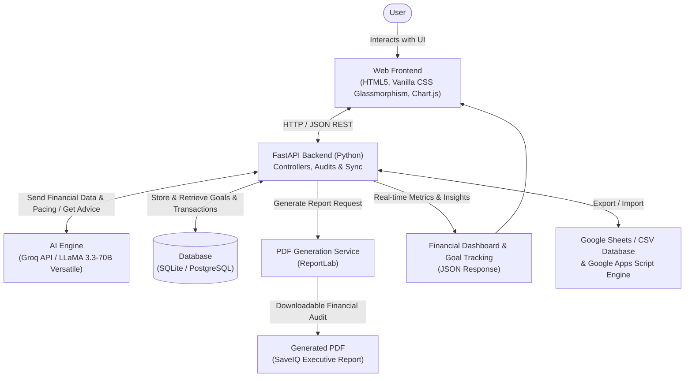

# SaveIQ – AI Savings Goal Tracker & Financial Analytics Platform


---

## 🌟 Overview

**SaveIQ** is an AI-powered personal finance management platform designed to help users define savings goals, track financial progress, and cultivate saving discipline through automated deadline audits, intelligent recommendations, and interactive visual analytics.

SaveIQ is provided with a **Dual-Architecture Deployment**:
1. **Modern Full-Stack App**: FastAPI (Python) + SQLite / PostgreSQL + Groq AI (LLaMA 3.3-70B Versatile) + ReportLab PDF Engine + Glassmorphic Responsive Web Interface.
2. **Serverless Cloud App**: Google Sheets Database + Google Apps Script + Gmail Services + Groq API Web App.

---

## 🏗️ System Architecture

Based on the system architecture diagram:



---

## 🎯 4 Core Scenarios Implemented

### 1. Savings Goal Creation & Categorization
- Define goals with **Name**, **Category** (*Emergency Fund, Tech & Gadgets, Travel & Vacation, Education, Vehicle, Home, Retirement*), **Target Amount**, **Initial Deposit**, **Target Deadline**, **Alert Email**, and **Purpose/Motivation**.
- Automatic calculation of pacing velocity (daily and weekly required contributions).

### 2. AI Financial Recommendations (Groq LLaMA 3.3-70B Versatile)
- Analyzes goal progress percentage, remaining balance, and days to deadline.
- Calculates an objective **Pacing Feasibility Score (0–100%)**.
- Generates tailored, 4-step actionable savings tactics (e.g. 50/30/20 rule budget adjustments, micro-investing, windfall allocations).
- Provides motivational financial coaching quotes.
- Features an intelligent, high-grade local FinTech heuristic fallback engine if an API key is not configured.

### 3. Automated Daily Deadline Alerts & Audit Engine
- Scans all savings goals against current calendar dates.
- Detects statuses: **Active**, **Urgent** (≤ 7 days left), **Warning** (≤ 30 days and < 60% progress), **Overdue**, and **Completed**.
- Records timestamped audit logs in the database.
- Dispatches automated HTML email notifications via Gmail / SMTP.

### 4. Financial Dashboard Monitoring & Visual Analytics
- Real-time KPI summary: **Total Saved**, **Total Target**, **Portfolio Completion Rate (%)**, and **Discipline Score (0–100)**.
- **Chart.js Visualizations**:
  - Interactive Doughnut chart for Category Savings Allocation.
  - Stacked Bar chart comparing Current Savings vs Remaining Gap across top goals.
- **ReportLab PDF Generator**: 1-click download of executive-grade financial reports formatted with custom typography, status badges, progress tables, and AI strategies.
- **Google Sheets Exporter**: Instant CSV download configured for direct Google Sheets synchronization.

---

## 📁 Repository Structure

```
d:/RAMESHWAR/
├── backend/
│   ├── config.py             # Environment variables, Groq settings, database path
│   ├── database.py           # SQLite connection pool, schema creation
│   ├── models.py             # Pydantic data validation schemas
│   ├── ai_service.py         # Groq AI (LLaMA 3.3-70B) & FinTech heuristic engine
│   ├── pdf_service.py        # ReportLab PDF report generation
│   ├── audit_service.py      # Automated daily financial audit & email dispatcher
│   ├── sheets_service.py     # Google Sheets CSV sync & export
│   ├── seed_data.py          # Realistic starter goals & transactions
│   ├── main.py               # FastAPI application with REST endpoints & static mounting
│   └── test_app.py           # Comprehensive automated test suite
├── frontend/
│   ├── index.html            # Ultra-premium Glassmorphic dashboard interface
│   ├── css/
│   │   └── styles.css        # Custom Vanilla CSS, themes (Dark/Light), micro-animations
│   └── js/
│       ├── api.js            # Frontend REST client
│       ├── charts.js         # Chart.js analytics controllers
│       └── app.js            # Dynamic rendering, modal controllers, toast alerts
├── google_apps_script/       # Complete ready-to-deploy Google Workspace edition
│   ├── Code.gs               # GAS backend (Sheets DB, Groq AI fetch, GmailApp alerts)
│   ├── Index.html            # Standalone GAS Web App HTML template
│   ├── appsscript.json       # OAuth scopes manifest
│   └── README_GAS.md         # 3-minute Google Sheets setup walkthrough
├── data/
│   └── saveiq.db             # Local SQLite database
├── requirements.txt          # Python dependencies
├── .env.example              # Environment variables template
├── run.py                    # Server launcher
└── README.md                 # Project documentation
```

---

## ⚡ Quick Start (Local Full-Stack App)

### 1. Prerequisites
- Python 3.8+ (tested on Python 3.13)
- Windows, macOS, or Linux

### 2. Configure Environment (Optional)
Copy `.env.example` to `.env`:
```bash
cp .env.example .env
```
Add your Groq API key:
```env
GROQ_API_KEY=gsk_your_groq_api_key_here
GROQ_MODEL=llama-3.3-70b-versatile
```
*(If no API key is provided, SaveIQ's built-in intelligent FinTech heuristic engine will run seamlessly).*

### 3. Launch SaveIQ
```bash
python run.py
```
- 🌐 **Web Dashboard:** [http://127.0.0.1:8000](http://127.0.0.1:8000)
- 📖 **Interactive Swagger Docs:** [http://127.0.0.1:8000/docs](http://127.0.0.1:8000/docs)

---

## 📊 Google Sheets & Google Apps Script Deployment

SaveIQ includes ready-to-paste scripts for deploying natively inside Google Workspace:
1. Open [Google Sheets](https://sheets.new) and name it `SaveIQ Financial Database`.
2. Go to **Extensions** > **Apps Script**.
3. Copy [`google_apps_script/Code.gs`](file:///d:/RAMESHWAR/google_apps_script/Code.gs) into `Code.gs`.
4. Create an HTML file named `Index` and copy [`google_apps_script/Index.html`](file:///d:/RAMESHWAR/google_apps_script/Index.html).
5. Add your `GROQ_API_KEY` under **Project Settings** > **Script Properties**.
6. Run `initializeSheetDatabase` and `setupDailyAuditTrigger`.
7. Click **Deploy** > **New deployment** > **Web app** (`Anyone` access).

Detailed instructions are available in [`google_apps_script/README_GAS.md`](file:///d:/RAMESHWAR/google_apps_script/README_GAS.md).

---

## 🧪 Automated Testing

SaveIQ includes an automated test suite verifying all 9 core subsystems:
```bash
python backend/test_app.py
```

### Verified Test Results:
- `[PASS]` Health check endpoint (`/api/health`)
- `[PASS]` Dashboard analytics summary calculation
- `[PASS]` Goal creation with validation and initial deposit
- `[PASS]` Transactional savings deposit recording and balance update
- `[PASS]` AI advisor recommendation with feasibility scoring and strategy generation
- `[PASS]` Automated daily financial audit and alert dispatch
- `[PASS]` Executive ReportLab PDF generation
- `[PASS]` Google Sheets CSV export
- `[PASS]` Frontend HTML serving
